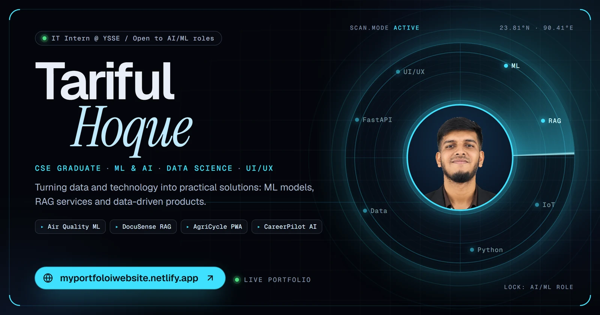
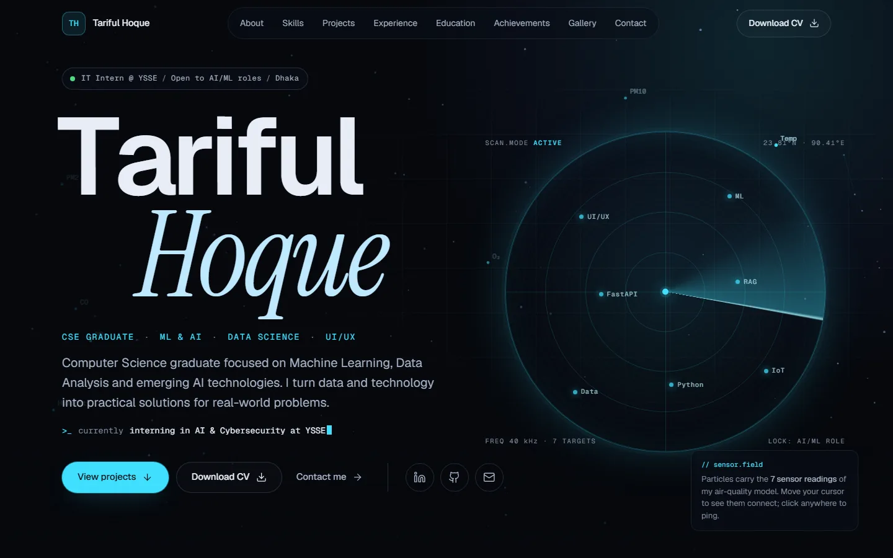
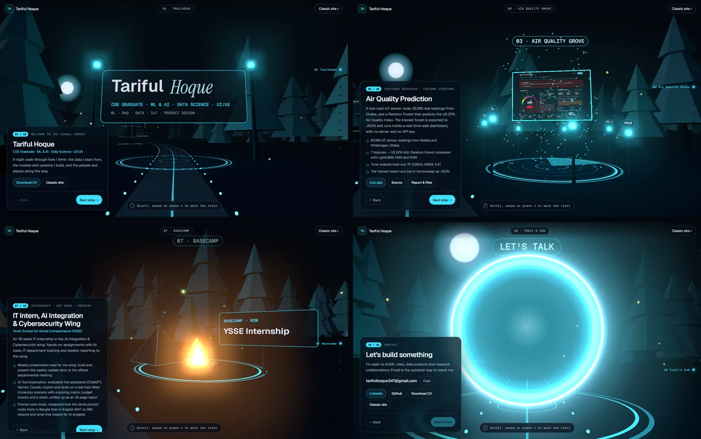
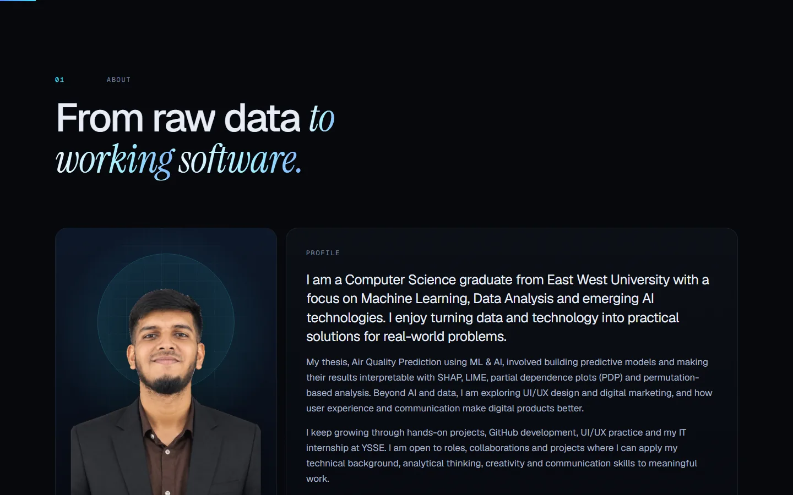
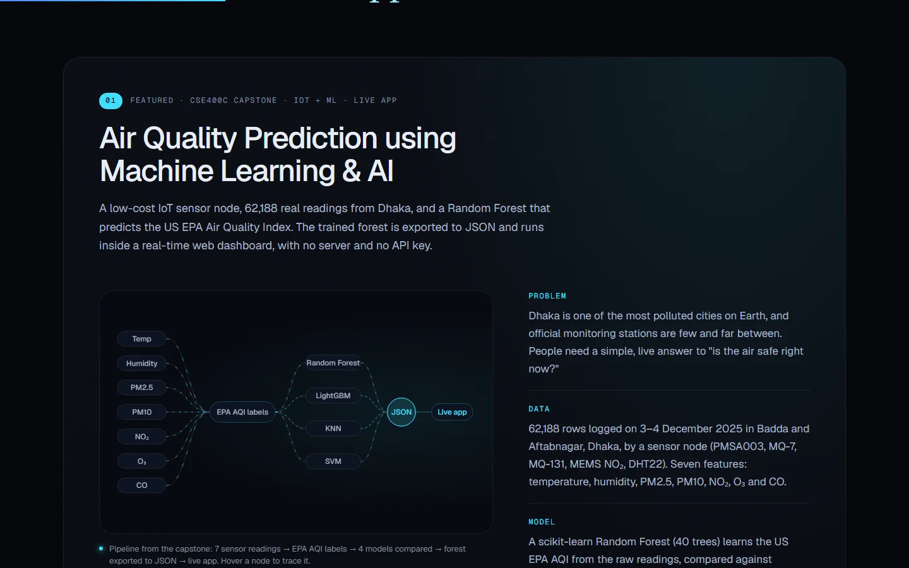
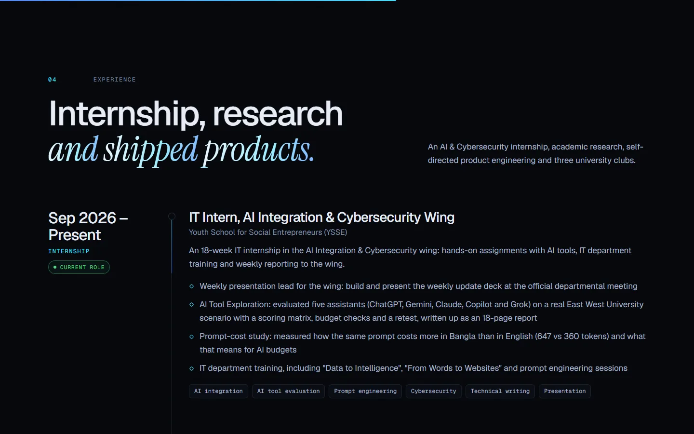
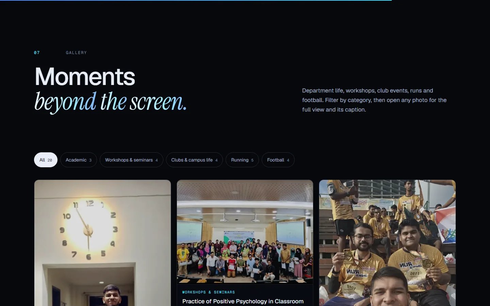
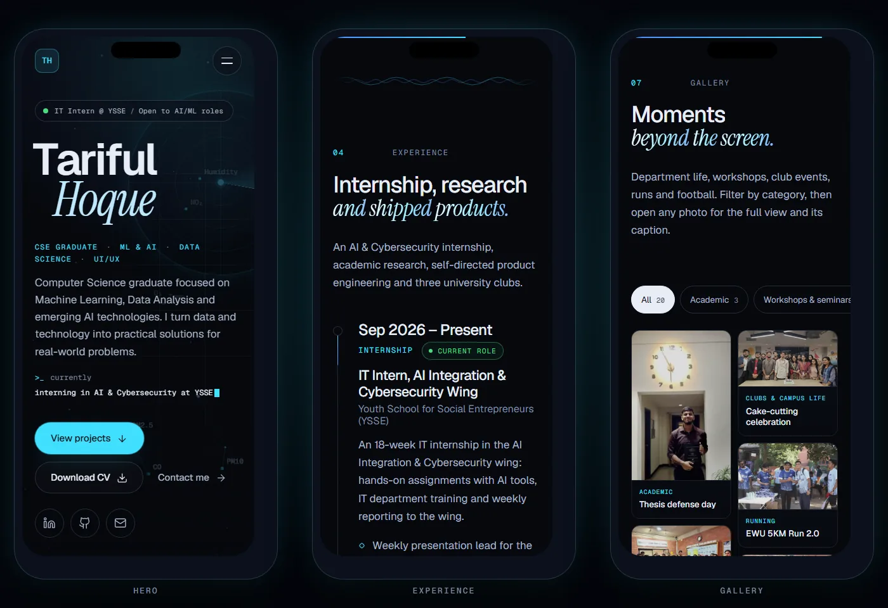
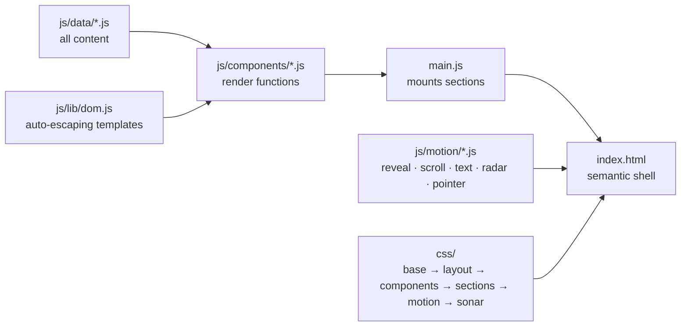

<a href="https://updatedportfoloiwebsite.netlify.app/">
  
</a>

<p align="center">
  <a href="https://updatedportfoloiwebsite.netlify.app/"></a>
  <a href="https://updatedportfoloiwebsite.netlify.app/experience.html"></a>
</p>

<p align="center">
  
  
  
  
  
  
  
  
  
</p>

<p align="center">
  <b>
  <a href="https://updatedportfoloiwebsite.netlify.app/">Open the site</a> ·
  <a href="#-the-signal-forest-3d">3D forest</a> ·
  <a href="#-highlights">Highlights</a> ·
  <a href="#-screenshots">Screenshots</a> ·
  <a href="#-featured-work">Featured work</a> ·
  <a href="#%EF%B8%8F-how-its-built">How it's built</a> ·
  <a href="#-run-it-locally">Run it</a> ·
  <a href="#-deploy">Deploy</a>
  </b>
</p>

---

The personal portfolio of **Tariful Hoque**, a Computer Science graduate from East West University (April 2026) and IT Intern in the AI Integration & Cybersecurity wing at YSSE. It brings together machine-learning research, AI services, product prototypes, experience, a captioned photo gallery and an ATS-friendly CV in one fast, static site.

Everything is hand-written **HTML, CSS and vanilla JavaScript**: no framework, no bundler, no `npm install`. Upload the folder and it is live. Alongside the classic site there is **The Signal Forest**, a 3D night-forest trail through the same content, built with Three.js.



## 🌲 The Signal Forest (3D)

> A portfolio should feel less like a résumé and more like an experience.

Press **Enter the 3D forest** on the hero (or open [`experience.html`](https://updatedportfoloiwebsite.netlify.app/experience.html)) and walk a night trail through ten stops: a trailhead gate, the *Roots* tree (education), the Air Quality radar grove, a DocuSense embedding cloud, the AgriCycle field, a workshop of product screens, the YSSE basecamp fire, orbiting skill families, a clearing of photos and a portal to contact.

<a href="https://updatedportfoloiwebsite.netlify.app/experience.html"></a>

| | |
|---|---|
| 🚶 **Walk** | Scroll, swipe or use the arrow keys; the camera follows a spline trail and settles at each stop. The rail and *Next stop* buttons jump anywhere. |
| 🧭 **Read** | Each stop opens a glass card with the real content (same `js/data` files as the classic site), placed on the side away from the landmark. |
| ✨ **Scene** | ~1,400 instanced low-poly pines, fireflies, stars, moonlight, fog, sonar rings and an Unreal bloom pass on desktop. Layout is seeded, so the forest is the same on every visit. |
| ♿ **Fallbacks** | Deep links like `experience.html#air-quality`, reduced-motion support, a lighter scene on phones, and a plain list when WebGL is unavailable. |

## ✨ Highlights

| | |
|---|---|
| 🌲 **3D Signal Forest** | A Three.js night-forest trail through the whole portfolio, one landmark per chapter (see above). |
| 📡 **"Ultrasonic" hero** | A radar with a rotating sweep, sonar pulses and skill blips that light up as the beam passes, a scanline, a typed *currently…* line and a particle field carrying the 7 sensor readings of the air-quality model. |
| 🔊 **Signal details** | A *Now scanning* tech ticker, oscilloscope-wave dividers between sections, and a sonar ping wherever you click. |
| 🧠 **Featured research** | Air Quality Prediction: an animated, hover-traceable model pipeline, the real numbers (62,188 readings, time-ordered R² 0.9933) and a live screenshot. |
| 🧩 **Evidence-linked skills** | Every skill links to the project or role where it was used. Filter by project to see which skills it proves. |
| 🗂️ **Projects** | AgriCycle, DocuSense RAG, CareerPilot AI, EcoBin 2.0 and Pulse with live demos and source links, plus smaller work. 3D tilt on hover. |
| 🧭 **Experience timeline** | YSSE internship (current role), AI & product engineering, capstone research and three campus clubs, with a rail that draws as you scroll. |
| 📸 **Gallery** | 20 captioned photos in 5 categories with filters, a masonry wall, HUD hover frames and a lightbox with keyboard arrows and swipe. |
| 👁 **Live visit counter** | A *portfolio visits* chip in the hero. Every visit adds one through the free [Abacus](https://abacus.jasoncameron.dev) API, and the number updates live over a server-sent event stream (polling as a fallback), with a glow on each new visit. Local testing never adds visits; the chip hides if the API is down. |
| 📄 **ATS-friendly CV** | One-click download of a 2-page, text-based PDF CV. |
| ♿ **Accessible by default** | Semantic landmarks, skip link, visible focus, keyboard-operable menu, filters and viewer. Under `prefers-reduced-motion` everything stops and renders in its final state. |
| ⚡ **Fast** | WebP images with lazy loading, no runtime dependencies, Google Fonts only. |

## 📸 Screenshots

<table>
  <tr>
    <td width="50%"><br><sub><b>About:</b> profile, numbers, process, status terminal</sub></td>
    <td width="50%"><br><sub><b>Featured:</b> Air Quality Prediction case study</sub></td>
  </tr>
  <tr>
    <td width="50%"><br><sub><b>Experience:</b> timeline with the current role</sub></td>
    <td width="50%"><br><sub><b>Gallery:</b> filters, captions, lightbox</sub></td>
  </tr>
</table>

<p align="center">
  
  <br><sub>Mobile-first: two-column gallery, sideways-scrolling filters and a full-screen menu on phones.</sub>
</p>

## 🚀 Featured work

| Project | What it is | Links |
|---|---|---|
| **Air Quality Prediction** | CSE400C capstone: IoT sensor node, 62,188 readings, Random Forest vs LightGBM / KNN / SVM, model running live in the browser | [Live app](https://airqualitypredictionapp.netlify.app/) · [Source](https://github.com/Majortarif/Air-Quality-Prediction-using-Machine-Learning-and-AI) |
| **AgriCycle** | Offline-first, Bangla-first PWA for farmers: direct market, crop-waste recycling matcher, green rewards | [Live demo](https://greencycle-farm.netlify.app/) · [Source](https://github.com/Majortarif/AgriCycle) |
| **DocuSense RAG** | Grounded RAG service with FastAPI, FAISS and Claude, anti-hallucination guardrails, 106 tests, Docker + CI | [Source](https://github.com/Majortarif/docusense-rag) |
| **CareerPilot AI** | 12-page career and skill intelligence prototype: CV and job analysis, skill gaps, 12-week roadmap | [Live demo](https://majortarif.github.io/CareerPilot-AI-AI-Powered-Career-Skill-Intelligence-Platform/) · [Source](https://github.com/Majortarif/CareerPilot-AI-AI-Powered-Career-Skill-Intelligence-Platform) |
| **EcoBin 2.0** | Smart waste management dashboard with route-optimization simulator | [Live demo](https://icy-leaf-c41a.tariful-ewu.workers.dev/) · [Source](https://github.com/Majortarif/ecobin-smart-waste-dashboard) |
| **Pulse** | Task and habit tracker with real streaks and a rule-based coach | [Live demo](https://ai-task-habit-tracker.netlify.app/) · [Source](https://github.com/Majortarif/ai-task-habit-tracker) |

## 🏗️ How it's built



| Layer | What it does |
|---|---|
| `index.html` | Semantic page shell, SEO and Open Graph tags, icon sprite, radar and ticker markup, contact form |
| `js/data/` | **All content**: profile, skills, projects, experience, education, achievements, gallery |
| `js/components/` | Small render functions that turn data into markup; every value is HTML-escaped by `js/lib/dom.js` |
| `js/motion/` | Particle field, scroll reveals, split-text and scramble effects, cursor effects, and `sonar.js` (pings, typer, cycler, tilt, radar pause) |
| `css/` | Design tokens and reset → layout → components → sections → motion → `sonar.css` (the ultrasonic layer) |

**Tech:** Three.js r160 (WebGL, InstancedMesh, UnrealBloomPass) · HTML5 · CSS3 (custom properties, `sin()`/`cos()` placement, conic gradients, CSS columns) · JavaScript ES modules · IntersectionObserver · Canvas 2D · `<dialog>` · Google Fonts (Geist, Geist Mono, Instrument Serif) · Lucide-style inline SVG icons · Netlify.

## 📁 Project structure

```text
My_portfoloi_website/
├── index.html            # classic site: page shell, meta tags, icon sprite
├── experience.html       # The Signal Forest (3D trail)
├── 404.html
├── netlify.toml          # headers, caching, no build step
├── robots.txt · sitemap.xml · site.webmanifest
├── assets/
│   ├── cv/Tariful_Hoque_CV.pdf
│   ├── icons/            # favicon + app icons
│   └── img/              # portrait, OG image, project shots, gallery (WebP)
├── css/
│   ├── base.css · layout.css · components.css
│   ├── sections.css · motion.css
│   ├── sonar.css         # radar, ticker, dividers, gallery, pings
│   └── forest.css        # 3D trail overlay: card, rail, loader
├── js/
│   ├── main.js           # mounts sections, then behaviour and motion
│   ├── data/             # ✏️ edit these to update the site
│   ├── components/
│   ├── motion/
│   ├── forest/           # Three.js scene: world, stations, chapters, overlay
│   └── lib/
└── docs/                 # README banner + screenshots (not used by the site)
```

## 💻 Run it locally

ES modules need a web server, so double-clicking `index.html` will not work.

```bash
git clone https://github.com/Majortarif/My_portfoloi_website.git
cd My_portfoloi_website
python -m http.server 8000
```

Then open <http://localhost:8000>.

## 🌐 Deploy

**Netlify Drop:** drag the folder (or a zip of it) onto <https://app.netlify.com/drop>, or onto your site's **Deploys** tab to update it.

**From GitHub:** connect this repository in Netlify with publish directory `.`. `netlify.toml` already sets the publish folder, a no-op build command, security headers and asset caching.

[](https://app.netlify.com/start/deploy?repository=https://github.com/Majortarif/My_portfoloi_website)

## ✏️ Updating content

Edit the files in `js/data/`; the page updates automatically.

- **Projects:** `projects.js`. `featured` is the case study, `builds` the main projects, `moreWork` the smaller ones.
- **Skills:** `skills.js`. Each skill lists its `evidence` (project ids, `'ysse'` or `'cv'`).
- **Experience / education:** `experience.js` (`current: true` adds the *Current role* badge), `education.js`.
- **Gallery:** `achievements.js`. Add `name.webp` (up to 1600 px) and `name-thumb.webp` (560 px tall) to `assets/img/gallery/`, then one entry with `cat`, `caption`, `text`, `alt`, `w` and `h`.
- **CV:** replace `assets/cv/Tariful_Hoque_CV.pdf`, keeping the file name.

## 👤 Author

**Tariful Hoque**: CSE Graduate | Machine Learning & AI | Data Science | UI/UX

[](https://updatedportfoloiwebsite.netlify.app/)
[](https://www.linkedin.com/in/tariful-hoque-582321259/)
[](https://github.com/Majortarif)
[](mailto:tarifulhoque347@gmail.com)

---

<p align="center"><sub>© 2026 Tariful Hoque. Content, photos and CV are personal; please don't reuse them without permission.</sub></p>
